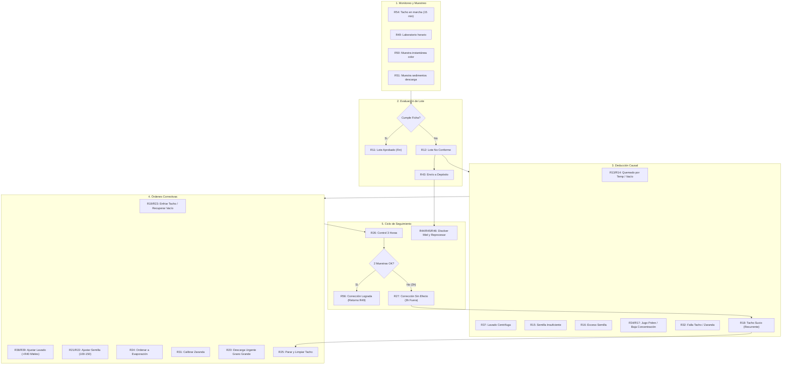

# DOCUMENTACIÓN TÉCNICA DEL SISTEMA BASADO EN CONOCIMIENTO (SBC)
## Asesor Virtual de Control de Calidad y Retroalimentación Operativa
### Ingenio La Esperanza — Grupo 10 | Ingeniería del Conocimiento (4to Año)

---

## 1. INTRODUCCIÓN Y ALCANCE DEL SISTEMA

### 1.1. Contexto del Problema
En el proceso de fabricación continua de azúcar del **Ingenio La Esperanza**, la calidad del producto final depende de variables físico-químicas críticas durante la cocción en los tachos al vacío, la separación centrífuga, el secado y la clasificación por zaranda.

La toma de decisiones en planta no es meramente clasificatoria (aprobar o rechazar un lote), sino fundamentalmente **retroalimentativa y correctiva**:
* Las mediciones horarias de laboratorio y los controles organolépticos del maestro azucarero deben traducirse de inmediato en directivas hacia etapas anteriores del proceso continuo (evaporadores, tachos, centrífugas, zarandas).
* El objetivo del SBC es desempeñarse como un **Asesor Virtual para el Jefe de Turno**, diagnosticando la causa raíz de las desviaciones y emitiendo órdenes operativas para estabilizar el proceso antes de que se generen lotes defectuosos masivos.

---

## 2. SUPUESTOS ADOPTADOS (CRITERIO CONSERVADOR: S1 A S12)

Debido a que durante las entrevistas iniciales de educción con el experto de dominio algunos rangos numéricos quedaron pendientes de validación fina, se adoptó el **criterio más conservador**: *ante la incertidumbre, se adopta el límite más estricto y la acción operativa menos invasiva antes de ordenar paradas o cortes drásticos*.

Cada supuesto queda codificado de **[S1] a [S12]** para su trazabilidad en el informe académico:

* **[S1] Escala Térmica del Tacho**:
  * **Normal**: hasta 70 °C (contiene el rango usual de trabajo informado de 50 a 60 °C).
  * **Alerta Preventiva (`temp_alerta`)**: entre 70 y 85 °C. Se advierte al personal y se chequea vacío sin forzar enfriamiento prematuro.
  * **Excedida Crítica (`temp_excedida`)**: superior a 85 °C. Dispara enfriamiento forzado hacia el rango 60–70 °C.
* **[S2] Presión de Vacío**:
  * **Unidad**: centímetros de mercurio ($\text{cmHg}$). (Una lectura de $60\text{ mmHg}$ representaría ausencia física de vacío).
  * **Vacío Normal**: 60 a 62 cmHg.
  * **Vacío Bajo (`vacio_bajo`)**: menor a 60 cmHg.
* **[S3] Concentración Brix del Jugo de Entrada**:
  * **Normal**: 60 a 63 °Bx.
  * **Bajo (`brix_bajo`)**: menor a 60 °Bx.
  * **Alto (`brix_alto`)**: mayor a 63 °Bx.
  * *Nota de diseño*: Los valores 55 y 65 °Bx se conservan como niveles críticos en la explicación diagnóstica, evitando franjas intermedias sin cobertura lógica.
* **[S4] Dosificación de Semilla**:
  * **Normal**: 100 a 150 unidades/volumen por tacho.
  * **Poca (`semilla_poca`)**: menos de 100.
  * **Mucha (`semilla_mucha`)**: más de 150.
  * *Nota*: La unidad física no distorsiona el motor inferencial al contrastarse estrictamente contra dichos umbrales relativos.
* **[S5] Criterio de Color Estricto**:
  * Se asume el límite inferior más exigente: $\le 150\text{ UI}$ para azúcar Blanco Directo (CTA) y $\le 400\text{ UI}$ para azúcar Crudo (salvo especificación contractual de 200 o 600 UI). Satisfaciendo el límite más riguroso, se asegura el cumplimiento de cualquier ficha.
  * La anomalía "color excesivamente claro" se procesa cualitativamente por observación visual en centrífuga.
* **[S6] Polarización (Pol)**:
  * **CTA**: mínimo $99.6\text{ }^\circ\text{Z}$ (se rectifica el valor "9.6" interpretándolo como error de tipeo/transcripción).
  * **Crudo**: mínimo $98.4\text{ }^\circ\text{Z}$.
* **[S7] Sedimentos e Insoluble**:
  * Máximo $30\text{ mg/kg}$ (ppm). Se descarta el porcentaje en peso (30 %) por carecer de coherencia física para azúcar comercial.
* **[S8] Granulometría de Azúcar Crudo**:
  * Rango normal: 0.60 a 0.65 mm, formulado por analogía de tolerancia al rango 0.50 a 0.55 mm del CTA.
* **[S9] Tipos de Azúcar y Tratamientos Químicos**:
  * CTA y Crudo poseen especificaciones analíticas independientes. El azúcar crudo se diferencia conceptualmente de la línea de Azúcar Orgánica.
  * Los aditivos químicos se limitan a Orgánica (**R47**: lechada de cal pura) y CTA (**R48**: sistema DOR con cal, azufre y floculante).
* **[S10] Ventanas Temporales de Control y Seguimiento**:
  * **Verificación de Inefectividad**: se aguardan hasta 3 horas (3 muestras analíticas horarias consecutivas) antes de considerar fallida una corrección, previniendo sobre-ajustes erráticos.
  * **Corrección Exitosa**: se valida con 2 muestras horarias consecutivas conformes a la ficha técnica.
* **[S11] Parámetros Operativos Supervisados**:
  * Variables no instrumentadas con sensores continuos (segundos de lavado en centrífuga, duración de parada y masa purgada de tacho) son orientadas cualitativamente por el SBC, delegando el ajuste fino al Jefe de Turno.
  * La humedad en secadores se clasifica por observación en: *seca*, *con terrones* o *húmeda*.
* **[S12] Desacople de Brix 33–37**:
  * Se identifica como una lectura intermedia de salida de evaporadores preliminares y queda aislada de las reglas activas de alimentación a tachos.

---

## 3. VALORES NUMÉRICOS Y FICHA TÉCNICA DE REFERENCIA

### 3.1. Parámetros del Tacho y Cocción
* **Vacío**: Normal 60–62 cmHg | Bajo $< 60\text{ cmHg}$.
* **Temperatura**: Normal $\le 70\text{ }^\circ\text{C}$ | Alerta $70\text{--}85\text{ }^\circ\text{C}$ | Excedida $> 85\text{ }^\circ\text{C}$ (Enfriamiento ordenado a $60\text{--}70\text{ }^\circ\text{C}$).
* **Brix Alimentación**: Normal 60–63 °Bx | Bajo $< 60\text{ }^\circ\text{Bx}$ | Alto $> 63\text{ }^\circ\text{Bx}$.
* **Semilla**: Normal 100–150 | Poca $< 100$ | Mucha $> 150$.
* **Punto de Descarga Estándar**: Masa cocida a $92\text{ }^\circ\text{Bx}$.
* **Muestreo de Operación**: Inspección de tacho cada 15 minutos por el maestro azucarero.

### 3.2. Ficha de Aceptación del Cliente (Laboratorio)
| Parámetro | Azúcar CTA (Blanco) | Azúcar Crudo | Unidad |
| :--- | :---: | :---: | :---: |
| **Color Máximo** | $\le 150$ (o 200) | $\le 400$ (o 600) | UI (ICUMSA) |
| **Granulometría Aceptable** | 0.50 – 0.55 | 0.60 – 0.65 | mm |
| **Retenido en Malla 25** | $\le 20$ | — | % |
| **Polarización (Pol) Mínima** | $\ge 99.6$ | $\ge 98.4$ | °Z |
| **Sedimentos Máximos** | $\le 30$ | $\le 30$ | mg/kg |

---

## 4. BASE DE CONOCIMIENTO (56 REGLAS DE PRODUCCIÓN)

### Bloque A: Mecanismo Físico del Tacho (14 Reglas)
* **R1**: SI `vacio_bajo` ($<60\text{ cmHg}$) [S2] $\rightarrow$ ENTONCES `temp_ebullicion_alta`.
* **R2**: SI `temp_ebullicion_alta` O `temperatura_tacho > 85 °C` [S1] $\rightarrow$ ENTONCES `temp_excedida`.
* **R55**: SI `70 °C <= temperatura_tacho <= 85 °C` [S1] $\rightarrow$ ENTONCES `temp_alerta`: alertar al tachero y verificar estanqueidad del vacío sin activar enfriamiento forzado.
* **R3**: SI `temp_excedida` $\rightarrow$ ENTONCES `azucar_quemado`.
* **R4**: SI `azucar_quemado` $\rightarrow$ ENTONCES `color_oscuro`.
* **R5**: SI `brix_alto` ($>63\text{ }^\circ\text{Bx}$) [S3] Y `semilla_poca` ($<100$) [S4] $\rightarrow$ ENTONCES `grano_grande`.
* **R6**: SI `brix_bajo` ($<60\text{ }^\circ\text{Bx}$) [S3] O `semilla_mucha` ($>150$) [S4] $\rightarrow$ ENTONCES `grano_chico`.
* **R7**: SI `grano_grande` ($>0.55\text{ mm}$ en CTA, $>0.65\text{ mm}$ en crudo) O `grano_chico` ($<0.50\text{ mm}$ en CTA, $<0.60\text{ mm}$ en crudo) [S8] $\rightarrow$ ENTONCES `granulometria_fuera`.
* **R8**: SI `brix_bajo` $\rightarrow$ ENTONCES `pureza_baja`. *(confirmar)*
* **R9**: SI `pureza_baja` $\rightarrow$ ENTONCES `granulometria_fuera`.
* **R10**: SI el tachero detecta grano grande táctil o visualmente en el toma-muestras $\rightarrow$ ENTONCES `grano_grande`.
* **R52**: SI Brix de entrada $<60$ $\rightarrow$ ENTONCES `brix_bajo`. SI $>63$ $\rightarrow$ ENTONCES `brix_alto` [S3].
* **R53**: SI Brix de masa cocida alcanza $92\text{ }^\circ\text{Bx}$ $\rightarrow$ ENTONCES `descargar_tacho`.
* **R54**: SI tacho en cocción $\rightarrow$ ENTONCES el maestro azucarero realiza toma de muestra de control cada 15 minutos.

### Bloque B: Muestreo y Dictamen de Calidad (6 Reglas)
* **R49**: SI transcurre 1 hora de operación continua (primera muestra a los 10–15 min de iniciar el turno) $\rightarrow$ ENTONCES laboratorio extrae muestra reglamentaria de lote.
* **R50**: SI el jefe de turno observa a simple vista desviación de color $\rightarrow$ ENTONCES notifica a laboratorio para activar muestras instantáneas (hasta 2 o 3 por hora).
* **R51**: SI se descarga tacho a centrífugas $\rightarrow$ ENTONCES laboratorio extrae muestra específica para dosaje de sedimentos.
* **R11**: SI los 4 parámetros analíticos satisfacen la ficha técnica [S5, S6, S7, S8] $\rightarrow$ ENTONCES `lote_aprobado`.
* **R12**: SI al menos un parámetro transgrede los límites de la ficha $\rightarrow$ ENTONCES `lote_no_conforme` y se dispara el protocolo diagnóstico.
* **R43**: SI `lote_no_conforme` $\rightarrow$ ENTONCES el laboratorio formaliza el rechazo y ordena el desvío físico a depósito de retención.

### Bloque C: Diagnóstico y Deducción Causal (9 Reglas)
* **R13**: SI `lote_no_conforme` Y `color_fuera` Y `temp_excedida` $\rightarrow$ ENTONCES `causa_color = quemado_por_temperatura`.
* **R14**: SI `causa_color = quemado_por_temperatura` Y `vacio_bajo` $\rightarrow$ ENTONCES `causa_raiz = perdida_de_vacio`.
* **R37**: SI `lote_no_conforme` Y `color_fuera` Y temperatura normal ($\le 70\text{ }^\circ\text{C}$) $\rightarrow$ ENTONCES `causa_color = lavado_centrifuga` y se somete a revisión el ciclo de lavado.
* **R15**: SI `lote_no_conforme` Y `granulometria_fuera` Y `grano_grande` Y `brix_alto` Y `semilla_poca` $\rightarrow$ ENTONCES `causa = semilla_insuficiente`.
* **R16**: SI `lote_no_conforme` Y `granulometria_fuera` Y `grano_chico` Y `semilla_mucha` $\rightarrow$ ENTONCES `causa = exceso_de_semilla`.
* **R34**: SI `grano_chico` Y `brix_bajo` $\rightarrow$ ENTONCES `causa = concentracion_baja_en_tacho`.
* **R17**: SI `brix_bajo` Y (`color_fuera` O `granulometria_fuera`) $\rightarrow$ ENTONCES `causa = jugo_de_entrada_pobre`.
* **R32**: SI `sedimentos_fuera` ($>30\text{ mg/kg}$) $\rightarrow$ ENTONCES auditar tachos de cocimiento y zaranda vibratoria.
* **R18**: SI (`color_fuera` O `granulometria_fuera`) Y `correccion_sin_efecto` $\rightarrow$ ENTONCES `causa = tacho_sucio`.

### Bloque D: Órdenes Correctivas y Directivas (12 Reglas)
* **R19**: SI `temp_excedida` $\rightarrow$ ENTONCES prescribir enfriamiento forzado del tacho hasta normalizar en $60\text{--}70\text{ }^\circ\text{C}$.
* **R20**: SI `grano_grande` $\rightarrow$ ENTONCES ordenar descarga inmediata del tacho sin aguardar los $92\text{ }^\circ\text{Bx}$ para evitar mayor desarrollo del cristal.
* **R21**: SI `causa = semilla_insuficiente` $\rightarrow$ ENTONCES incrementar dosificación de semilla en las próximas templas (dentro del rango 100–150).
* **R22**: SI `causa = exceso_de_semilla` $\rightarrow$ ENTONCES reducir dosificación de semilla (dentro del rango 100–150).
* **R23**: SI `causa_raiz = perdida_de_vacio` $\rightarrow$ ENTONCES ordenar restitución y sellado del sistema de vacío para operar en $60\text{--}62\text{ cmHg}$.
* **R24**: SI `causa = jugo_de_entrada_pobre` O `causa = concentracion_baja_en_tacho` $\rightarrow$ ENTONCES instruir al sector de evaporadores concentrar más el jugo y bombear masa a $60\text{--}63\text{ }^\circ\text{Bx}$.
* **R25**: SI `causa = tacho_sucio` $\rightarrow$ ENTONCES separar la masa a reproceso, parar el tacho y ejecutar ciclo de limpieza física [S11].
* **R33**: SI `grano_chico` $\rightarrow$ ENTONCES emitir advertencia operativa a maestros azucareros.
* **R38**: SI `color_oscuro` Y `causa_color = lavado_centrifuga` $\rightarrow$ ENTONCES incrementar gradualmente tiempo de lavado con agua/vapor en centrífugas [S11].
* **R39**: SI color excesivamente claro (inspección) Y `causa_color = lavado_centrifuga` $\rightarrow$ ENTONCES reducir tiempo de lavado en centrífugas [S11].
* **R40**: SI se incrementa el tiempo de lavado en centrífugas $\rightarrow$ ENTONCES emitir advertencia explicativa de disolución y aumento colateral de volumen de mieles.
* **R31**: SI `sedimentos_fuera` $\rightarrow$ ENTONCES ordenar calibración, tensado y ajuste de mallas de zaranda.

### Bloque E: Seguimiento y Ciclo de Retroalimentación (3 Reglas)
* **R26**: SI se emitió orden correctiva (R19–R25, R31, R33, R38, R39) $\rightarrow$ ENTONCES auditar la evolución analítica durante 3 muestras horarias sucesivas [S10], manteniendo inspección del maestro cada 15 min.
* **R27**: SI tras cumplirse 3 horas de aplicada la corrección persiste el apartamiento de ficha [S10] $\rightarrow$ ENTONCES dictaminar `correccion_sin_efecto`.
* **R56**: SI tras una corrección se registran 2 muestras horarias consecutivas conformes a la ficha [S10] $\rightarrow$ ENTONCES dictaminar `correccion_lograda` y retornar a régimen ordinario.

### Bloque F: Destino del Lote Rechazado (3 Reglas)
* **R44**: SI el lote se encuentra en depósito de retención $\rightarrow$ ENTONCES proceder a disolución de azúcar para conversión a miel y reingreso al circuito.
* **R45**: SI se produce la reinyección de miel disuelta $\rightarrow$ ENTONCES presentar al Jefe de Turno las 3 alternativas técnicas: tanque de jugo encalado, miel de segunda o dilución sectorial.
* **R46**: SI el lote está en depósito $\rightarrow$ ENTONCES calibrar de forma integral lavado, centrifugación, zaranda y cocimiento hasta estabilizar la fábrica.

### Bloque G: Reglas de Contexto y Contingencias Operativas (9 Reglas)
* **R28**: SI falta el maestro azucarero de primera y no media relevo $\rightarrow$ ENTONCES habilitar al maestro de segunda instruyéndolo en priorizar el control estricto de temperatura y grano.
* **R29**: SI el tachero detecta color oscuro antes de la muestra horaria $\rightarrow$ ENTONCES chequear prioritariamente temperatura del tacho y Brix de entrada.
* **R30**: SI se efectúa el sembrado $\rightarrow$ ENTONCES conservar dosis uniforme (100–150) y perfil parejo de Brix.
* **R35**: SI se identifica `granulometria_fuera` en zaranda bajo marcha continua $\rightarrow$ ENTONCES prohibir el retamizado en línea durante el proceso.
* **R36**: SI el lote culmina la producción con `granulometria_fuera` $\rightarrow$ ENTONCES autorizar el retamizado en seco de lote cerrado.
* **R41**: SI en secadores se observa azúcar con terrones (`humedad_baja`) $\rightarrow$ ENTONCES asentar registro preventivo en bitácora [S11].
* **R42**: SI en secadores se observa azúcar húmeda que escurre miel (`humedad_alta`) $\rightarrow$ ENTONCES asentar alarma por riesgo comercial inminente [S11].
* **R47**: SI `tipo = organica` $\rightarrow$ ENTONCES dosificar únicamente lechada de cal pura, suprimiendo azufre y floculantes sintéticos.
* **R48**: SI `tipo = A (CTA)` $\rightarrow$ ENTONCES procesar con azufre, cal y floculantes en sistema DOR, optimizando el ciclo de lavado centrífugo.

---

## 5. GRAFO Y CAMINOS DE INFERENCIA

El flujo inferencial del sistema opera bajo encadenamiento hacia adelante (*Forward Chaining*) a través de **13 caminos estructurados**:

---

## 6. ESTUDIO Y SELECCIÓN DE HERRAMIENTAS

### 6.1. Capacidades Técnicas Demandadas por las 56 Reglas
1. **Encadenamiento Hacia Adelante (*Data-Driven*)**: Propagación reactiva desde mediciones de sensores y análisis de laboratorio hacia el diagnóstico.
2. **Comparadores Numéricos de Rango en LHS**: Evaluación en una sola fase de variables continuas ($<70$, $70\text{--}85$, $>85\text{ }^\circ\text{C}$; $<60$, $60\text{--}63$, $>63\text{ }^\circ\text{Bx}$, etc.).
3. **Mecanismo Nativo de Prioridad (*Salience*)**: Capacidad para arbitrar entre órdenes de emergencia (R25, R20) y ajustes suaves (R19, R21).
4. **Retracción y Mutación Dinámica de Hechos (*Truth Maintenance*)**: Necesaria para que al deducirse `correccion_sin_efecto` (R27) se invalide el diagnóstico preliminar y tome control `tacho_sucio` (R18).
5. **Manejo de Estado Temporal e Historial de Muestras**: Soporte para rastrear secuencias de 2 y 3 horas de muestras horarias (R26, R27, R56).
6. **Módulo de Explicabilidad y Advertencias**: Posibilidad de registrar por qué se emitió una sugerencia y emitir advertencias colaterales (R40, R45).
7. **Bajo Costo de Adopción e Integración**: Ejecución directa en entornos de desarrollo sin requerir servidores empresariales pesados.

### 6.2. Matriz de Decisión Multicriterio

Se evaluaron las herramientas tecnológicas consideradas en la cátedra puntuando de 1 a 10 según su adecuación:

| Herramienta | Motor Adelante (x10) | Curva Adopción (x8) | Integración (x8) | Enfoque Industrial (x8) | Documentación (x10) | **Puntaje Total** |
| :--- | :---: | :---: | :---: | :---: | :---: | :---: |
| **Python (Experta / durable)** | **9 (90)** | **10 (80)** | **10 (80)** | **7 (56)** | **8 (80)** | **386** |
| **DROOLS (Java)** | 10 (100) | 5 (40) | 9 (72) | 10 (80) | 9 (90) | **382** |
| **JSON Rules Engine (Node.js)** | 7 (70) | 9 (72) | 10 (80) | 8 (64) | 8 (80) | **366** |
| **CLIPS (Nativo C/LISP)** | 10 (100) | 4 (32) | 6 (48) | 7 (56) | 7 (70) | **306** |
| **SWI-Prolog** | 3 (30) | 5 (40) | 7 (56) | 5 (40) | 9 (90) | **256** |
| **CLisp** | 6 (60) | 3 (24) | 5 (40) | 4 (32) | 6 (60) | **216** |

### 6.3. Justificación de la Elección
* **Descarte de SWI-Prolog**: Al utilizar encadenamiento hacia atrás (*Backward Chaining* guiado por metas), obligaría a forzar la lógica declarativa para emular la llegada continua de hechos en un proceso industrial reactivo.
* **Descarte de JSON Rules Engine**: Carece de memoria de trabajo persistente basada en Rete y no gestiona retracciones dinámicas ni bucles temporales de retroalimentación (R26/R27/R56).
* **DROOLS vs Python**: Aunque DROOLS posee altísimo rendimiento industrial, requiere una arquitectura pesada en Java (Maven, KIE workbench, DRL files) que introduce una complejidad de configuración desmedida frente a **Python**, que implementa el algoritmo Rete nativo con sintaxis directa, rápida integración y bajo mantenimiento.

---

## 7. ANÁLISIS DE CONJUNTOS DE CONFLICTO Y ESTRATEGIAS DE RESOLUCIÓN

### 7.1. Definición Teórica
En los sistemas basados en reglas de producción, el **Conjunto de Conflicto** (*Conflict Set*) es el conjunto de reglas cuyas premisas (*LHS / Antecedentes*) resultan verdaderas simultáneamente frente a un mismo estado de la memoria de trabajo (*Working Memory*), compitiendo por disparar (*fire*).

### 7.2. Identificación de Conflictos Críticos y Mejores Estrategias

#### Conflicto 1: Diagnóstico Competitivo (R17 vs R34)
* **Escenario**: Jugo con `brix_bajo` ($<60\text{ }^\circ\text{Bx}$) y granulometría fuera con `grano_chico` ($<0.50\text{ mm}$).
  * **R34**: `grano_chico Y brix_bajo` $\rightarrow$ `causa = concentracion_baja_en_tacho`.
  * **R17**: `granulometria_fuera Y brix_bajo` $\rightarrow$ `causa = jugo_de_entrada_pobre`.
* **Mejor Alternativa**: **Especificidad (*Specificity*)**. R34 exige el síntoma granular concreto (`grano_chico`), mientras que R17 es genérica. R34 recibe mayor salience. Ambas derivan de manera consistente en la orden correctiva **R24** a evaporadores.

#### Conflicto 2: Conflicto Sensorial vs. Instrumental (R10 vs R6)
* **Escenario**: El tachero palpa grano grande en el toma-muestras (**R10**), pero el balance de tacho/laboratorio reporta grano chico por exceso de semilla (**R6**).
* **Mejor Alternativa**: **Atributo Único y Precedencia Instrumental**. El hecho `Lote` define el atributo `tamano_grano ∈ {"chico", "normal", "grande"}` como valores mutuamente excluyentes. La apreciación táctil de R10 es una alerta temprana presuntiva que se sobreescribe cuando arriba la medición analítica cuantitativa.

#### Conflicto 3: Concurrencia de Órdenes Incompatibles (R19, R20, R25)
* **Escenario**: Falla múltiple simultánea (temperatura $>85\text{ }^\circ\text{C}$ con grano $>0.55\text{ mm}$, y posible acumulación de falla previa por tacho sucio).
* **Mejor Alternativa**: **Salience Categórico por Niveles de Severidad**:
  1. `Salience 100` (Crítico de Fábrica): **R25** (`tacho_sucio`). Se para el tacho y se limpia.
  2. `Salience 80` (Emergencia de Calidad): **R20** (`descarga inmediata`). Evita que el grano siga creciendo; enfriar no achicará el cristal.
  3. `Salience 50` (Ajustes Operativos en Marcha): **R19** (enfriar), **R21/R22** (semilla), **R23** (vacío), **R24** (evaporación).
  4. `Salience 20` (Alertas y Avisos): **R55** (alerta 70–85 °C), **R33** (aviso a maestros).

#### Conflicto 4: Decisión de Descarga (R20 vs R53)
* **Escenario**: Se alcanzan $92\text{ }^\circ\text{Bx}$ (**R53**: descarga normal), pero simultáneamente se detecta grano grande (**R20**: descarga urgente anticipada).
* **Mejor Alternativa**: **Salience Superior + Guarda de Estado**. R20 tiene mayor salience (80) que R53 (40). Al ejecutarse R20, asienta `TachoDescargado(motivo="emergencia_grano_grande")`, inhabilitando la condición de disparo de R53.

#### Conflicto 5: Diagnóstico Preliminar vs. Falla Recurrente (R18 vs R13–R17)
* **Escenario**: Se aplicó una orden de ajuste pero tras 3 horas el parámetro sigue fuera (**R27**: `correccion_sin_efecto`). El sistema debe pasar a diagnosticar `tacho_sucio` (**R18**).
* **Mejor Alternativa**: **Retracción de Diagnóstico Previo y Refracción**. Al afirmarse `correccion_sin_efecto`, el motor retrae la causa original (`semilla_insuficiente` o `quemado`) y R18 dispara con Salience 100, evitando bucles repetitivos de ajuste.

#### Conflicto 6: Dictamen Aprobado vs. No Conforme (R11 vs R12)
* **Escenario**: Evaluación global de los 4 parámetros de laboratorio.
* **Mejor Alternativa**: **Evaluación Lógica Disjunta**.
  $$\text{R11: } \text{Color}_{OK} \land \text{Granulo}_{OK} \land \text{Pol}_{OK} \land \text{Sedim}_{OK}$$
  $$\text{R12: } \neg(\text{Color}_{OK} \land \text{Granulo}_{OK} \land \text{Pol}_{OK} \land \text{Sedim}_{OK})$$
  Por definición de complementariedad lógica, son formalmente disjuntas e incompatibles de integrar la agenda simultáneamente.

---

### 7.3. Matriz Jerárquica de Salience para Implementación

| Nivel de Salience | Reglas Asignadas | Justificación Operativa |
| :---: | :---: | :--- |
| **100** | **R25, R18** | Parada del equipo, lavado físico y reproceso por tacho sucio (máxima criticidad de planta). |
| **80** | **R20, R43** | Acciones de corte inmediato (descarga forzada para frenar grano, rechazo formal a depósito). |
| **60** | **R12, R13, R14, R15, R16, R17, R32, R34, R37** | Diagnóstico deductivo y asignación de causa raíz (*R34 con mayor salience que R17*). |
| **50** | **R19, R21, R22, R23, R24, R31, R38, R39** | Despacho de directivas operativas de calibración y regulación en marcha. |
| **40** | **R11, R53, R56** | Operación ordinaria de rutina (aprobación de lote, descarga normal a 92 °Bx, fin de seguimiento). |
| **20** | **R55, R33, R40, R41, R42** | Alertas preventivas, notificaciones al personal y avisos colaterales (aumento de volumen de mieles). |

---

## 8. CONCLUSIÓN
El presente marco consolida la especificación formal del SBC para el Ingenio La Esperanza, integrando una base de conocimiento rigurosa con 56 reglas, 12 supuestos de diseño estables, un grafo de inferencia completo y una estrategia sólida de resolución de conflictos para su implementación computacional en Python.
